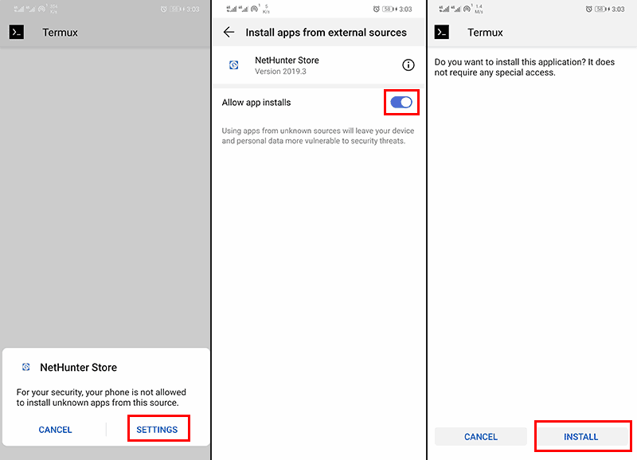
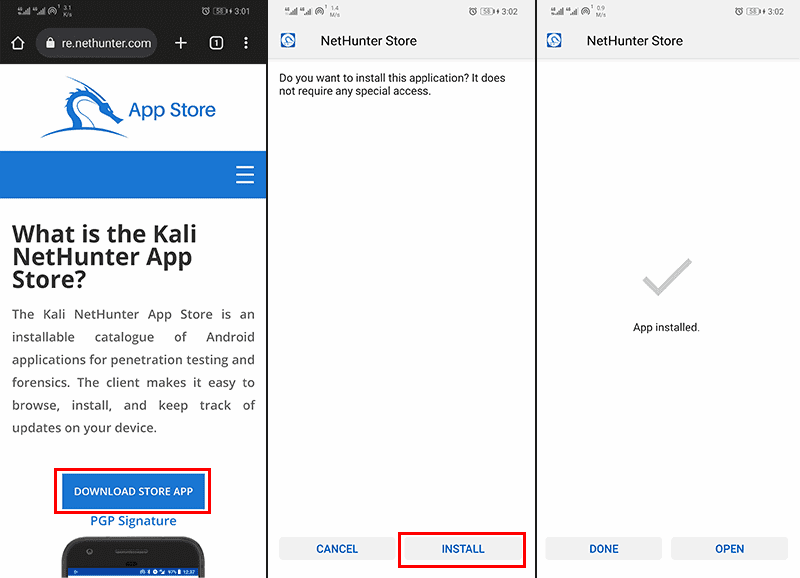
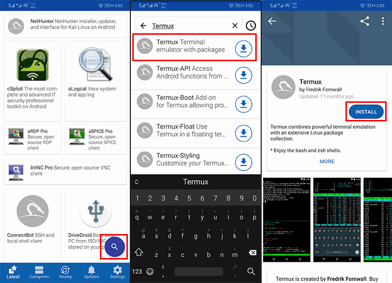
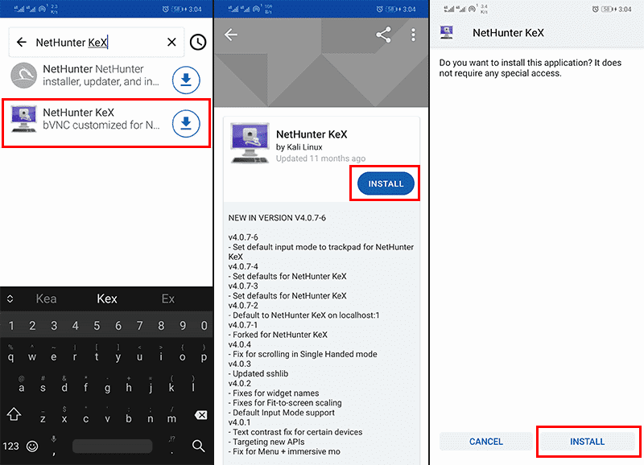
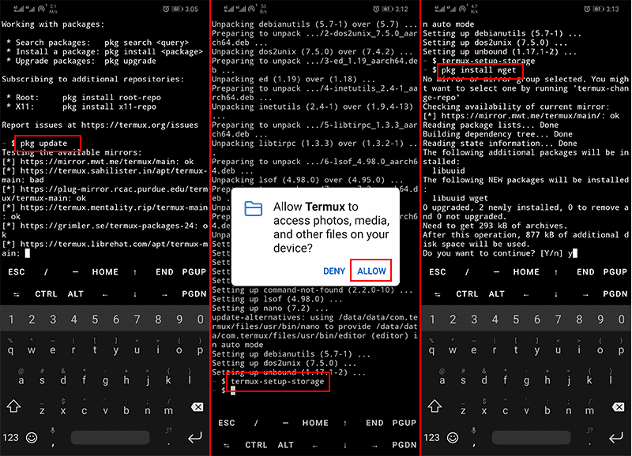
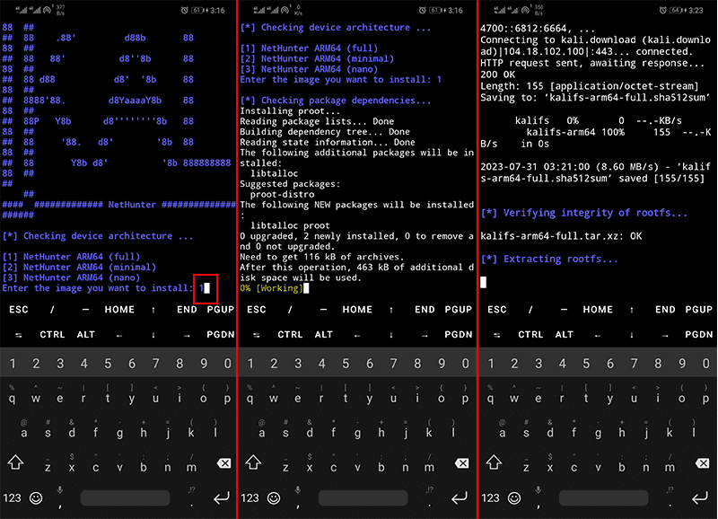
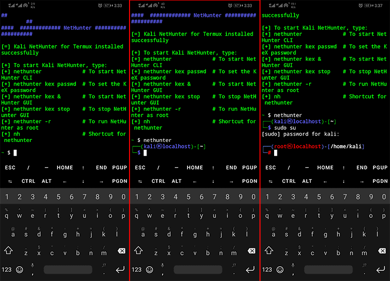
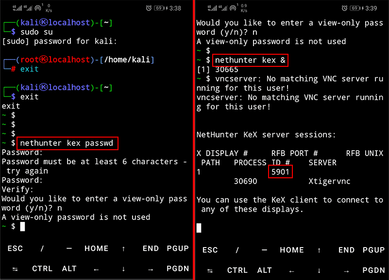
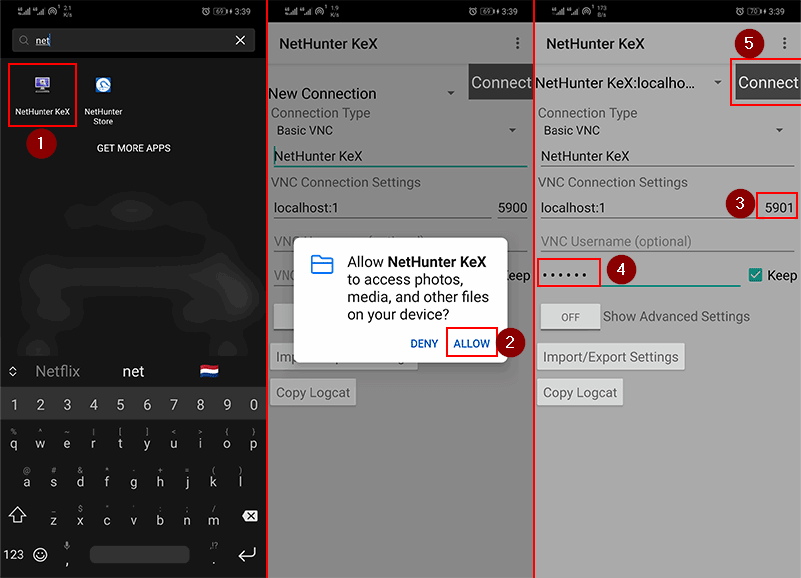

# Kali Linux on Android (No Root Required)

A comprehensive, step-by-step guide to installing and running a full Kali Linux environment on your Android device using Termux and NetHunter KeX.

## Table of Contents

- [Introduction](#introduction)
- [Prerequisites](#prerequisites)
- [Installation Guide](#installation-guide)
  - [1. Install Kali NetHunter App Store](#1-install-kali-nethunter-app-store)
  - [2. Install Termux Terminal](#2-install-termux-terminal)
  - [3. Install NetHunter KeX](#3-install-nethunter-kex)
  - [4. Install the Kali Linux CLI in Termux](#4-install-the-kali-linux-cli-in-termux)
  - [5. Access the Kali Linux Desktop](#5-access-the-kali-linux-desktop)
- [Conclusion](#conclusion)

## Introduction

Have you ever wanted to carry the premier penetration testing operating system in your pocket? With this guide, you can install a fully functional Kali Linux environment directly on your Android phone **without needing to root your device**. 

We achieve this by using **Termux** (a powerful terminal emulator) to create an isolated Linux environment (via PRoot) and **NetHunter KeX** to render the full desktop graphical interface. This setup grants you access to Kali's extensive toolkit, making it perfect for on-the-go security research, ethical hacking, and learning Linux.

## Prerequisites

Before starting, ensure you have the following:
- An Android device (Root access is **not** required).
- A stable internet connection (you will need to download around 2GB of data).
- At least **5GB to 8GB of free storage space** on your device.

---

## Installation Guide

### 1. Install Kali NetHunter App Store

The NetHunter App Store is a customized repository of Android applications specifically tailored for security and penetration testing. We need it to download the specialized versions of the tools we'll be using.

- Download the [Kali NetHunter App Store APK](https://store.nethunter.com).
- Transfer the downloaded APK file to your Android device.
- Navigate to your device's **Settings > Security** (or Apps) and enable **Install Unknown Apps** for your file manager or browser.
  
  

- Tap on the APK to install the NetHunter App Store.

  

### 2. Install Termux Terminal

**Termux** is an Android terminal emulator and Linux environment app that works without rooting or setup. **Note:** *Always download Termux from the NetHunter Store or F-Droid, as the Google Play Store version is deprecated and no longer receives updates.*

- Open the newly installed **Kali NetHunter App Store**.
- Use the search feature to find **Termux Terminal (emulator with packages)**.

  

- Tap **Install**. (If prompted, you will need to grant the NetHunter Store permission to install apps).

### 3. Install NetHunter KeX

**NetHunter KeX** is an Android app that allows you to connect to the Kali Linux graphical desktop environment via a local VNC server.

- Still inside the NetHunter App Store, search for **NetHunter KeX**.

  

- Tap **Install** and proceed with the installation.

### 4. Install the Kali Linux CLI in Termux

Now we will use the Termux command line to download and install the core Kali Linux system.

1. **Update packages:** Open the **Termux** app and type the following command to ensure all base packages are up to date. Press Enter and type `y` if prompted during the process.
   ```bash
   pkg update && pkg upgrade
   ```

2. **Grant storage permissions:** Termux needs permission to read and write to your device's internal storage.
   ```bash
   termux-setup-storage
   ```
   *A popup will appear asking for storage permission; tap **Allow**.*

3. **Install `wget`:** This is a command-line utility used to download files from the internet.
   ```bash
   pkg install wget
   ```
   
   

4. **Download the installer script:** Fetch the official Kali NetHunter installation script using `wget`.
   ```bash
   wget -O install-nethunter-termux https://offs.ec/2MceZWr
   ```

5. **Make the script executable:** Before you can run the script, you must grant it execution permissions.
   ```bash
   chmod +x install-nethunter-termux
   ```

6. **Run the installation script:** Start the installation. This step will take some time as it downloads the large Kali rootfs (filesystem) image and extracts it. 
   ```bash
   ./install-nethunter-termux
   ```
   
   

7. **Launch Kali:** Once the installation finishes, you can enter the Kali Linux Command Line Interface (CLI) anytime by typing:
   ```bash
   nethunter
   ```
   *(Shortcut: You can also just type `nh`)*
   
   

8. **(Optional) Run as root:** To get full administrative (root) privileges inside your Kali environment, use:
   ```bash
   sudo su
   ```
   *(The default password is `kali` if prompted).*

### 5. Access the Kali Linux Desktop

Using the command line is great, but a full desktop environment is much more powerful.

1. **Set a VNC password:** While inside the Kali CLI, you need to create a password to secure your desktop session. You will be asked to enter a password and verify it (choose something you will remember).
   ```bash
   nethunter kex passwd
   ```
   *(When asked to enter a view-only password, you can safely type `n` for No).*

2. **Start the KeX server:** Launch the background service that will host your desktop.
   ```bash
   nethunter kex &
   ```
   
   
   
   *Pay attention to the output; it will specify a port number (usually `5901` or `1`).*

3. **Connect via the App:** Open the **NetHunter KeX** application on your phone.
   - Leave the connection address as `localhost:1` (or change the `1` if your port was different, e.g., `5902` -> `localhost:2`).
   - Enter the **password** you created in step 1.
   
   

4. **Launch the Desktop:** Tap the **Connect** button at the top right.

**Congratulations!** You are now running a full Kali Linux desktop environment right on your Android smartphone.


*Note: When you are finished, you should properly shut down the KeX server to save battery. Back in Termux, type `nethunter kex stop`.*

## Conclusion

This guide provides a straightforward and safe method to install Kali Linux on an Android device without the risks associated with rooting. Whether you are practicing penetration testing, learning ethical hacking, or just want to explore Linux, you now have a versatile security toolkit conveniently in your pocket.
